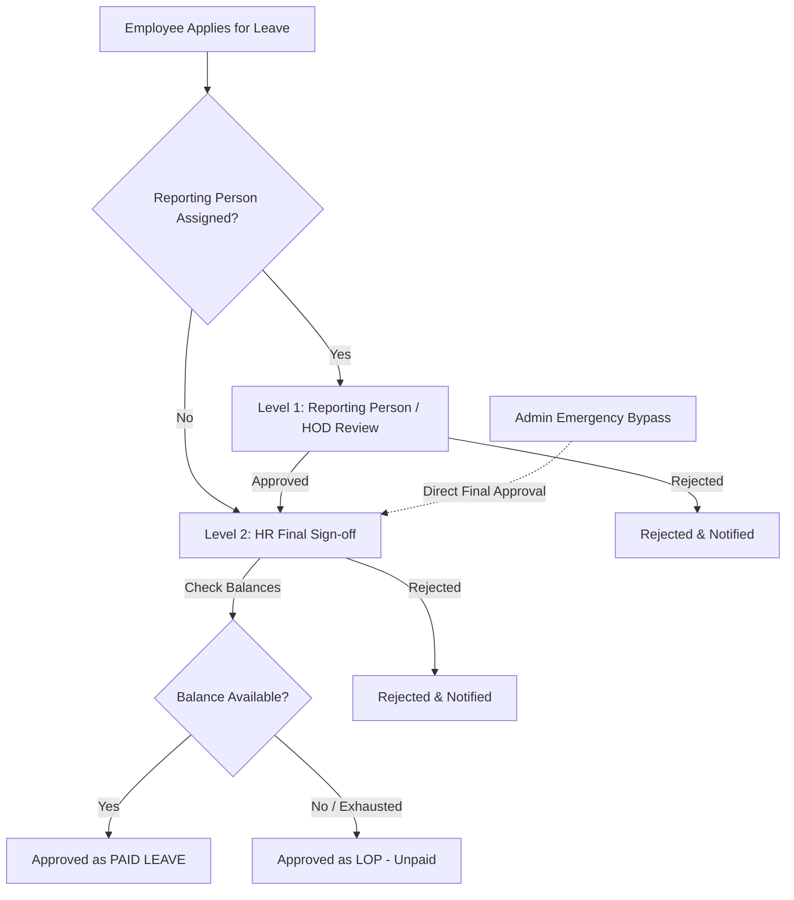

# Leave Management, Leave Categories & Payroll Architecture Plan

## 1. Executive Summary & Problem Analysis

In a 24/7 healthcare environment like **Neha Hospitals**, staff work in multi-shift rotations (day, evening, night) across doctors, clinical nurses, technicians, and administrative staff. 

Our investigation into the existing codebase revealed several critical gaps between leave recording, attendance, and payroll:

```
┌─────────────────────────────────────────────────────────────────────────────────────────────┐
│                                   CURRENT GAP ANALYSIS                                      │
├───────────────────────────────┬─────────────────────────────────────────────────────────────┤
│ 1. Zero Balances              │ leave_balances has 0 rows. Because there is no auto-quota   │
│                               │ engine, EVERY approved leave immediately defaults to LOP!   │
├───────────────────────────────┼─────────────────────────────────────────────────────────────┤
│ 2. Unpaid Absence Leakage     │ Payroll only deducts status='lop'. If an employee is marked │
│                               │ 'absent' without applying for leave, they receive full pay! │
├───────────────────────────────┼─────────────────────────────────────────────────────────────┤
│ 3. Category Confusion         │ "Weekly Off" is stored as a leave type (quota 4) instead of │
│                               │ a shift roster schedule. No Comp-Off or Half-Day support.   │
├───────────────────────────────┼─────────────────────────────────────────────────────────────┤
│ 4. Half-Day Blocked           │ Half-day is hard-blocked with an error, yet hospital staff  │
│                               │ frequently require 0.5-day morning/evening shift coverage.  │
├───────────────────────────────┼─────────────────────────────────────────────────────────────┤
│ 5. Approval Bottleneck        │ If an employee has no reporting person assigned, leave      │
│                               │ requests are permanently stuck and cannot reach HR.         │
└───────────────────────────────┴─────────────────────────────────────────────────────────────┘
```

This plan outlines a modern, enterprise-grade architecture for **Leave Categories**, **Automated Balances**, **Flexible Approvals**, and **Airtight Payroll Calculation**.

---

## 2. Redesigned Leave Categories & Policies

We separate operational roster off-days from actual statutory and company leave types:

| Code | Leave Category | Type | Annual / Monthly Quota | Carry Forward | Half-Day Allowed | Medical Cert Required | Payroll Impact |
| :--- | :--- | :--- | :--- | :--- | :--- | :--- | :--- |
| **CL** | **Casual Leave** | Paid | 12 days/yr (1 day/mo) | No (Lapses Dec 31) | **Yes (0.5 day)** | No | ₹0 Deduction (Paid) |
| **SL** | **Sick / Medical Leave**| Paid | 12 days/yr (1 day/mo) | Up to 15 days | **Yes (0.5 day)** | Yes (if > 2 days) | ₹0 Deduction (Paid) |
| **EL** | **Earned / Privilege** | Paid | 15 days/yr (Accrued) | Yes (Max 30 days) | No (Full days only)| No | ₹0 Deduction (Paid) |
| **CO** | **Compensatory Off** | Paid | Earned dynamically | Valid 90 days | **Yes (0.5 day)** | No | ₹0 Deduction (Paid) |
| **ML** | **Maternity Leave** | Statutory | 26 Weeks (Statutory) | N/A | No | Yes | ₹0 Deduction (Statutory) |
| **PL** | **Paternity Leave** | Paid | 5 days | No | No | No | ₹0 Deduction (Paid) |
| **BL** | **Bereavement Leave** | Paid | 3 days | No | No | Yes (Proof on file)| ₹0 Deduction (Paid) |
| **LOP**| **Loss of Pay (Unpaid)**| Unpaid | 0 (Unlimited) | N/A | **Yes (0.5 day)** | No | **Deducts Daily Rate** |

> [!IMPORTANT]
> **Separation of "Weekly Off"**: Weekly Off is an **HR Shift Roster attribute** (`staff_roles.weekly_off_count`), not a requestable leave category. Employees will no longer apply for "Weekly Off" as a leave type.

---

## 3. Automated Leave Balance & Accrual Engine

### A. Automatic Annual & Prorated Quota Initialization
- **New Joiners**: When an employee is created in HR, the system automatically assigns their leave balances prorated from their date of joining to December 31.
  - *Example*: Staff Nurse joins on July 1 $\rightarrow$ Automatically credited with $6 \text{ CL}$ and $6 \text{ SL}$ for the remainder of the year.
- **Yearly Rollover (January 1st)**:
  - CL & Casual quotas reset to 12.
  - EL carry-forward balances roll over up to the capped maximum (e.g., 30 days).
  - Unused LOP/Comp-Offs expired past 90 days are safely archived.

### B. Dynamic Comp-Off (CO) Accrual
- When an employee is rostered for a **Weekly Off** or **Public Holiday** but their biometric punch/attendance records $\ge 6$ hours of work:
  - System flags: *"Worked on Weekly Off / Holiday"*.
  - Automatically credits $+1.0 \text{ CO}$ balance (or $+0.5 \text{ CO}$ if worked half shift).
  - Employee can apply for Comp-Off within 90 days, or choose payout in payroll.

---

## 4. Half-Day (0.5) Leave Support

In hospital shifts, clinicians and administrative staff often need half-day flexibility (e.g., attending an afternoon symposium, morning medical appointment):

1. **Duration Unit**:
   - `leave_requests` will record `duration_type`: `'full_day'`, `'first_half'`, or `'second_half'`.
   - `total_days`: `1.0` for full day, `0.5` for half day.
2. **Attendance Interaction**:
   - When an approved half-day leave is recorded, the employee is expected to punch in for the remaining half shift.
   - Attendance status becomes: `half_day_leave` (0.5 Day Paid + 0.5 Day Shift).
3. **Payroll Impact**:
   - If paid leave balance is available: Consumes $0.5$ from balance, **no salary deducted**.
   - If balance is 0: Deducts **$0.5 \times \text{Daily Rate}$** instead of docking a full day's wage!

---

## 5. Modern Two-Tier Approval Chain with Administrative Override



### Improvements:
1. **Reporting Person Fallback**: If an employee has no reporting person (`reporting_person_id IS NULL`) or the reporting person is on leave, the request escalates directly to HR/Admin.
2. **Decision Preview Card**: When HR opens a request to review:
   - Displays live balance: *"Available CL: 3 days. Request: 2 days."*
   - Shows projected outcome: *"Approving this will consume 2 CL days (Paid Leave). Remaining balance will be 1 CL."*
   - If balance is 0: Warns *"Balance exhausted (0 available). Approving will record as LOP (2 days salary deduction)."*

---

## 6. Airtight Leave-Integrated Payroll Calculation

### A. The Core Principle: Zero Unpaid Absence Leakage
Currently, an unapproved absence is not counted as LOP unless someone manually triggers an unexplained absence record. 

In the reformed payroll engine, **every calendar day of the month is accounted for**:

$$\text{Calendar Days} = \text{Present Days} + \text{Paid Leave Days} + \text{Rostered Week Offs} + \text{Unpaid LOP Days}$$

Any unworked, unrostered, and unapproved day is **automatically detected as LOP**.

### B. Standardized Salary Computation Formula

```javascript
// 1. Daily Wage Rate
const calDays = daysInMonth(month, year); // 28, 29, 30, or 31
const dayRate = fixedMonthlySalary / calDays;

// 2. Total LOP Days (Full + Half Days + Unexcused Absences)
const totalLopDays = approvedLopDays + unexcusedAbsentDays + (halfDayLopDays * 0.5);

// 3. Paid Days Credit
const paidDays = calDays - totalLopDays;

// 4. Earned Basic & HRA
const earnedBasic = Math.round((basicDa / calDays) * paidDays);
const earnedHra   = Math.round((hra / calDays) * paidDays);
const earnedSalary = earnedBasic + earnedHra;

// 5. Overtime / Comp-Off Payouts / Night Shift Allowances
const nightComponent = nightShiftCount * nightShiftAllowance;
const weekOffWorkedPay = unutilizedWeekOffsWorked * dayRate;
const extraDaysPay = extraDaysWorked * dayRate;

// 6. Gross Earnings
const earnedGross = earnedSalary + nightComponent + weekOffWorkedPay + extraDaysPay;

// 7. Statutory & Company Deductions
// PF (12% of Earned Basic capped at ₹15,000)
const pfWage = isPfApplicable ? Math.min(earnedBasic, 15000) : 0;
const pfEmployee = isPfApplicable ? Math.round(pfWage * 0.12) : 0;

// ESI (0.75% of Earned Gross if fixed monthly gross <= ₹21,000)
const esiEmployee = (isEsiApplicable && fixedMonthlySalary <= 21000)
  ? Math.ceil(earnedGross * 0.0075)
  : 0;

// Approved Fines (Late attendance fines, disciplinary deductions)
const totalDeductions = pfEmployee + esiEmployee + finesAmount;

// 8. Net Take-Home Pay
const netPay = Math.max(0, earnedGross - totalDeductions);
```

### C. Comparison: Current vs Proposed Payroll Engine
| Feature | Current Engine | Proposed Engine |
| :--- | :--- | :--- |
| **Absence without Leave** | Paid full salary unless manual fine triggered | **Automatically deducted as LOP** |
| **Half-Day LOP** | Not supported (0 or 1 day) | **Deducts exact $0.5 \times \text{dayRate}$** |
| **Paid Leave Impact** | Deducted if balance table is empty | **Protected by automated quota engine** |
| **Comp-Off Payout** | Ad-hoc calculation | **Reconciled against earned comp-off ledger** |
| **Audit Visibility** | Opaque single LOP amount | **Itemized breakdown: Approved LOP vs Unexcused Absenteeism** |

---

## 7. Frontend User Interface Improvements

### A. Leave Hub (`/admin#leave`)
1. **Leave Requests Tab**:
   - Modern filter strip: *Pending My Review*, *Pending HR*, *Approved Paid*, *Approved LOP*, *Rejected*.
   - Inline **Leave Balance Preview** on each request row.
   - Quick one-click approval buttons with confirmation modal showing financial impact.
   - Support for **Half-Day (First Half / Second Half)** toggle when applying.
2. **Leave Balances Tab**:
   - Switch from single employee lookup to an **Organization-Wide Balance Overview** table (searchable by department, designation, employee).
   - `[+ Credit / Adjust Balance]` modal for HR adjustments (e.g. manual Comp-Off award, annual quota bonus) with audit notes.
3. **Leave Types Tab**:
   - Clean management of hospital leave categories with badges (*Paid*, *Unpaid*, *Half-Day Allowed*, *Carries Forward*).
   - Hardcoded protection on system categories (`CL`, `SL`, `EL`, `LOP`).
4. **Leave Calendar View**:
   - Department-level month calendar highlighting who is on leave each day to prevent clinical under-staffing (e.g., alert if $>30\%$ of ICU nurses are on leave on the same shift).

### B. Payroll Run Screen (`/admin#payroll`)
- **Detailed Attendance & Leave Inspector Drawer**:
  - Clicking on any employee's payslip row displays an exact day-by-day attendance audit:
    - *Present: 24 days*
    - *Paid Leave (CL/SL): 2 days (₹0 deduction)*
    - *Week Offs: 4 days (₹0 deduction)*
    - *Half-Day LOP: 1 day (0.5 day deduction = ₹416)*
    - *Unexcused Absent: 0 days*
    - *Total Deducted LOP Days: 0.5 days*

---

## 8. Implementation Steps & Phasing

```
┌────────────────────────────────────────────────────────────────────────────────────────┐
│                                 PHASED ROLLOUT PLAN                                    │
├─────────────────┬──────────────────────────────────────────────────────────────────────┤
│ Phase 1: DB &   │ • Clean up leave_types (purge junk, add CL, SL, EL, CO, ML, LOP).   │
│ Schema Updates  │ • Add duration_type ('full_day', 'first_half', 'second_half') to     │
│                 │   leave_requests.                                                    │
│                 │ • Add comp_off_ledger for tracking weekend/holiday overtime credits. │
│                 │ • Auto-populate leave_balances for all active staff for 2026.        │
├─────────────────┼──────────────────────────────────────────────────────────────────────┤
│ Phase 2: Engine │ • Rewrite leave.service.js to support 0.5 half-days, automatic quota │
│ & Logic         │   allocation, and reporting person fallback.                         │
│                 │ • Update salary.service.js attendance aggregation to detect unexcused│
│                 │   absenteeism and 0.5 half-day LOP cleanly.                          │
├─────────────────┼──────────────────────────────────────────────────────────────────────┤
│ Phase 3: Web UI │ • Upgrade Leave.jsx: Half-day selector, org-wide balance sheet,      │
│ Redesign        │   decision balance preview, and cleaner tab navigation.              │
│                 │ • Upgrade Payroll.jsx: Payslip breakdown drawer showing itemized     │
│                 │   paid leave vs LOP deductions.                                      │
├─────────────────┼──────────────────────────────────────────────────────────────────────┤
│ Phase 4: Audit  │ • End-to-end verification with sample scenarios (1.5 day CL,         │
│ & Verification  │   exhausted balance LOP, working on week off -> Comp-Off, payslip).  │
└─────────────────┴──────────────────────────────────────────────────────────────────────┘
```
