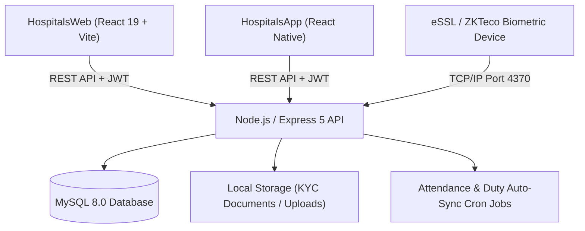

# 🏥 Neha Hospital ERP & Hospital Management System (HMS)

[](https://nodejs.org/)
[](https://expressjs.com/)
[](https://react.dev/)
[](https://vitejs.dev/)
[](https://www.mysql.com/)
[](https://www.docker.com/)

**Neha Hospital ERP** is an enterprise-grade Hospital Management System (HMS) and Enterprise Resource Planning (ERP) platform designed for healthcare facilities. It provides clinical workflow automation, inpatient bed management, pharmacy inventory & POS billing, biometric attendance synchronization, dynamic duty rosters, and HR & payroll operations.

---

## 📑 Table of Contents

- [Architectural Overview](#-architectural-overview)
- [System Features & Modules](#-system-features--modules)
  - [1. Clinical & Patient Operations](#1-clinical--patient-operations)
  - [2. Pharmacy & Inventory Management](#2-pharmacy--inventory-management)
  - [3. Human Resources & Staff Management](#3-human-resources--staff-management)
  - [4. Shift Models & Weekly Duty Roster](#4-shift-models--weekly-duty-roster)
  - [5. Biometric Attendance Synchronization](#5-biometric-attendance-synchronization)
  - [6. Strict Monthly Payroll & Statutory Compliance](#6-strict-monthly-payroll--statutory-compliance)
  - [7. Role-Based Access Control (RBAC) & Security](#7-role-based-access-control-rbac--security)
- [Project Directory Structure](#-project-directory-structure)
- [Getting Started](#-getting-started)
  - [Prerequisites](#prerequisites)
  - [Environment Variables Configuration](#environment-variables-configuration)
  - [Database Setup](#database-setup)
  - [Running the Backend API](#running-the-backend-api)
  - [Running the Web Application](#running-the-web-application)
  - [Running the Mobile App (React Native)](#running-the-mobile-app-react-native)
- [Docker & Containerized Deployment](#-docker--containerized-deployment)
- [Biometric Hardware Integration (eSSL / ZKTeco)](#-biometric-hardware-integration-essl--zkteco)
- [API Route Directory](#-api-route-directory)

---

## 🏛️ Architectural Overview



The system is organized into a decoupled, service-oriented architecture:
- **Web Frontend (`HospitalsWeb`)**: Built with React 19 and Vite for high responsiveness, featuring real-time data tables, interactive modals, responsive clinical cards, and tabular scheduling views.
- **Mobile Client (`HospitalsApp`)**: React Native cross-platform application for Android and iOS.
- **Backend API (`Backend`)**: Modular Express 5 REST API utilizing connection pooling (`mysql2/promise`), JWT session authentication, route-level permission gates, rate limiting, and Multer file upload handling.
- **Database (`Sql`)**: Normalized MySQL 8.0 relational schema with constraints, audit trails, and transactional consistency.
- **Hardware Integration**: Dedicated socket client for eSSL / ZKTeco biometric attendance terminals running over local TCP/IP.

---

## 🏥 System Features & Modules

### 1. Clinical & Patient Operations
- **Patient Registration & Master Index**: Unified patient records with contact details, gender, age/DOB, and unique patient IDs.
- **Token & Appointment Queue**: Real-time outpatient department (OPD) queue manager supporting token assignment, doctor selection, visit categorization, and live queue status.
- **Doctor Consultations & E-Prescriptions**: Integrated consultation desk capturing clinical vitals, symptoms, diagnosis, and prescription details.
- **Inpatient Ward & Bed Management**: Visual bed allocation board tracking available, occupied, and maintenance beds across wards and rooms.
- **Admission & Discharge Processing**: Streamlined inpatient admission forms, bed transfers, and automated discharge summaries.

### 2. Pharmacy & Inventory Management
- **Medicine Stock Tracking**: Real-time inventory monitoring with batch numbers, expiry dates, manufacturers, and reorder levels.
- **Point of Sale (POS) Billing**: Rapid pharmacy checkout with automated tax computation, batch selection, and stock deduction.
- **Payment Collection & Receipts**: Unified billing supporting cash, UPI, card, and insurance payments with printable receipts.

### 3. Human Resources & Staff Management
- **Department & Designation Hierarchy**: Structured departmental mapping with baseline salaries and role definitions.
- **Staff KYC & Identity Documents**:
  - Validated **Aadhar Number** and **PAN Number** records.
  - Multi-format file uploads (`.pdf`, `.jpg`, `.jpeg`, `.png`) up to 10MB stored securely in `Backend/uploads/` and viewable via authenticated links.
- **Bank & Branch Details**: Structured bank account tracking including Account Number, IFSC Code, and Branch Name.
- **Statutory EPF & ESI Configuration**: Enrollment flags and Universal Account Number (UAN) / ESI registration tracking per employee.

### 4. Shift Models & Weekly Duty Roster

The platform features an advanced 4-category shift architecture:

| Shift Category | Timing Rule | Edit Behavior in Add/Edit Employee | Schedule Workflow |
| :--- | :--- | :--- | :--- |
| **☀️ Day Shift (`day`)** | Hospital-wide fixed timing (e.g. `09:00 – 17:00`) | **Non-editable** (Displays locked hospital hours) | Fixed daily daytime schedule |
| **🌙 Night Shift (`night`)** | Hospital-wide fixed timing (e.g. `20:00 – 08:00`) | **Non-editable** (Displays locked hospital hours) | Fixed daily overnight schedule |
| **🔄 Day & Night Shift (`day_and_night`)** | Duty Roster assigned | **No shift timing asked** (Displays Roster notice) | Scheduled weekly via Weekly Duty Roster |
| **⏱️ General Shift (`general`)** | Individual custom working hours | **Editable** (`custom_shift_start` & `end`) | Individual employee fixed schedule |

- **Hospital-Wide Shift Timings Configuration**: Interactive configuration modal accessible directly from the Employee Directory, Add Member form, and Duty Roster to modify global Day/Night shift hours and grace periods.
- **Wednesday-to-Wednesday Duty Roster**: Specialized 7-day schedule grid (Wed → Tue cycle) for `day_and_night` staff with quick keyboard/click presets:
  - `D`: Day Shift
  - `N`: Night Shift
  - `WO`: Week Off
- **Single-Day Shift Overrides**: Override engine enabling administrators to assign custom date-specific time ranges for any employee with instant attendance precedence.

### 5. Biometric Attendance Synchronization
- **eSSL Device Connectivity**: Automated background polling and manual sync via TCP/IP (`port 4370`).
- **Intelligent Punch Pairing**: Matches in-punches and out-punches against configured shifts, calculating total working hours, overtime, and late arrivals.
- **Grace Period Engine**: Configurable grace period buffer (in minutes) for late check-in detection.
- **Leave & Loss of Pay (LOP)**: Integrated leave applications, approvals, and automated LOP detection for absent days.

### 6. Strict Monthly Payroll & Statutory Compliance
- **Strict Monthly Salary Model**: All salaries operate strictly on a monthly basis (`salary_type = 'monthly'`).
- **Shift-Category Specific Calculations**:
  - **General, Day, and Night Shifts**: User inputs **Monthly Basic Salary (₹)**; system auto-computes:
    $$\text{Per Day Rate} = \frac{\text{Monthly Basic Salary}}{30}$$
  - **Day & Night Shift**: User inputs **Per Day Shift Salary (₹)** and **Per Night Shift Salary (₹)**; system auto-computes:
    $$\text{Monthly Base Salary} = \text{Per Day Shift Salary} \times 30$$
    $$\text{Night Shift Extra} = \max(0, \text{Per Night Shift Salary} - \text{Per Day Shift Salary})$$
- **Statutory Deductions**: Automated calculations for Employee Provident Fund (EPF @ 12%), Employee State Insurance (ESI), late penalty deductions, and disciplinary fines.
- **One-Click Excel Export**: Generates comprehensive `.xlsx` payroll workbooks with individual employee line items, allowances, statutory deductions, and net pay (strictly excluding overtime per hospital policy).

### 7. Role-Based Access Control (RBAC) & Security
- **Granular Permission Gates**: Endpoint-level security (`gate('hr_employee.view')`, `gate('salary.create')`).
- **JWT Authentication**: Signed JSON Web Tokens with refresh token rotation and configurable expiration.
- **API Rate Limiting**: Dual-tier rate limiting protecting authentication routes from brute-force attacks and general routes from DoS.

---

## 📂 Project Directory Structure

```text
NehaHospitals/
├── Backend/                            # Node.js & Express 5 REST API
│   ├── src/
│   │   ├── app.js                      # Express application setup & middleware
│   │   ├── config/                     # Database connection pool & environment configs
│   │   ├── middleware/                 # Auth gate, RBAC, Multer upload, rate limiter
│   │   ├── modules/                    # Domain feature modules
│   │   │   ├── attendance/             # Biometric logs, punch calculation, eSSL sync
│   │   │   ├── auth/                   # Login, token refresh, credentials
│   │   │   ├── bed/                    # Inpatient admissions, wards & bed status
│   │   │   ├── consultation/           # OPD clinical visits & prescriptions
│   │   │   ├── hr/                     # Staff, departments, roles, shift roster
│   │   │   ├── leave/                  # Leave applications & approval workflows
│   │   │   ├── patient/                # Patient registrations & appointments
│   │   │   ├── payment/                # Billing, receipts & collections
│   │   │   ├── pharmacy/               # Medicine inventory & POS billing
│   │   │   ├── rbac/                   # Roles, permissions & user access gates
│   │   │   ├── salary/                 # Payroll runs, salary revisions, Excel export
│   │   │   ├── system/                 # Global settings & doctor fees
│   │   │   └── users/                  # User accounts & staff mapping
│   │   └── util/                       # Helper functions, logger, date utilities
│   ├── uploads/                        # Uploaded KYC documents (Aadhar & PAN)
│   ├── server.js                       # HTTP server entrypoint
│   ├── Dockerfile                      # Backend Docker container specification
│   └── package.json
│
├── HospitalsWeb/                       # React 19 Web Application (Vite)
│   ├── src/
│   │   ├── assets/                     # Static images, icons, logos
│   │   ├── components/                 # Reusable UI components (Modals, Tables, Nav)
│   │   ├── pages/                      # Application route pages
│   │   │   ├── admin/                  # Administrative & management portal
│   │   │   │   ├── departmentrole/     # Department & Add Member forms
│   │   │   │   ├── shiftroster/        # Weekly Duty Roster & Shift Timing Modal
│   │   │   │   ├── HREmployees.jsx     # Staff directory, profile & salary editor
│   │   │   │   ├── Payroll.jsx         # Payroll runs & Excel export
│   │   │   │   ├── Attendance.jsx      # Biometric attendance monitor
│   │   │   │   └── ...                 # Appointments, Beds, Pharmacy, etc.
│   │   │   └── auth/                   # Login & password recovery pages
│   │   ├── util/                       # API fetch client, date & currency formatters
│   │   ├── App.jsx                     # Root React router & auth context
│   │   └── main.jsx                    # Application bootstrapping
│   ├── Dockerfile                      # Web production container specification (Nginx)
│   └── package.json
│
├── HospitalsApp/                       # React Native Mobile Application
│   ├── android/                        # Android native project & Gradle configs
│   ├── ios/                            # iOS native project & Xcode workspace
│   ├── App.tsx                         # Mobile application root
│   └── package.json
│
├── Sql/                                # Database Schemas & Migration Patches
│   ├── neha_hospital_schema-v8.sql     # Baseline consolidated schema
│   ├── patch_v9_employee_docs_shift_model.sql # Shift model & KYC patch
│   └── ...                             # Historical migration logs
│
├── docker-compose.yml                  # Multi-container orchestration specification
├── .env.example                        # Template environment variables
├── push.ps1                            # Docker Hub build & deployment script
└── README.md                           # Project documentation
```

---

## 🚀 Getting Started

### Prerequisites

Ensure you have the following installed on your development workstation:
- **Node.js**: `v20.x` or higher
- **npm**: `v10.x` or higher
- **MySQL Server**: `v8.0` or higher (or Docker Desktop)
- **Git**

---

### Environment Variables Configuration

Copy the `.env.example` file to create your local `.env` files:

#### 1. Root `.env` (Used for Docker and environment defaults)
```bash
cp .env.example .env
```

#### 2. Backend Environment (`Backend/.env`)
Create `Backend/.env` with the following configuration:
```env
PORT=7000
NODE_ENV=development
WEB_ORIGIN=http://localhost:5173,http://localhost:8086

# MySQL Database
DB_HOST=localhost
DB_PORT=3306
DB_USER=root
DB_PASS=your_mysql_password
DB_NAME=nehahospitals
DB_SSL=false

# JWT Configuration
JWT_SECRET=your_super_secret_jwt_key_here
JWT_REFRESH_TOKEN=your_super_secret_refresh_key_here
JWT_EXPIRES_IN=24h
PROTECTED_ROUTES_ENABLED=true

# Biometric Attendance Device (Optional local testing)
ESSL_DEVICE_IP=192.168.1.201
ESSL_DEVICE_PORT=4370
ESSL_AUTO_SYNC_ENABLED=false
```

#### 3. Frontend Web Environment (`HospitalsWeb/.env`)
Create `HospitalsWeb/.env`:
```env
VITE_API_URL=http://localhost:7000/api
```

---

### Database Setup

1. Log into your MySQL database instance:
   ```bash
   mysql -u root -p
   ```
2. Create the hospital database:
   ```sql
   CREATE DATABASE nehahospitals CHARACTER SET utf8mb4 COLLATE utf8mb4_unicode_ci;
   EXIT;
   ```
3. Import the baseline schema and the latest migration patches:
   ```bash
   mysql -u root -p nehahospitals < Sql/neha_hospital_schema-v8.sql
   mysql -u root -p nehahospitals < Sql/patch_v9_employee_docs_shift_model.sql
   ```

---

### Running the Backend API

```bash
cd Backend
npm install
npm run dev
```
The API server will start at **`http://localhost:7000`**.

---

### Running the Web Application

In a separate terminal window:
```bash
cd HospitalsWeb
npm install
npm run dev
```
The web dashboard will be available at **`http://localhost:5173`**.

---

### Running the Mobile App (React Native)

```bash
cd HospitalsApp
npm install

# For Android
npx react-native run-android

# For iOS (macOS required)
cd ios && pod install && cd ..
npx react-native run-ios
```

---

## 🐳 Docker & Containerized Deployment

The application includes production-ready Docker configurations orchestrated with `docker-compose.yml`.

### Spin up the entire stack locally:
```bash
docker compose up -d --build
```

### Services launched:
| Service | Container Name | Internal Port | Exposed Port | Description |
| :--- | :--- | :--- | :--- | :--- |
| **MySQL** | `nehahospital-mysql` | `3306` | `3312` | MySQL 8.0 Database with persistent volume |
| **Backend API** | `nehahospital-backend` | `5000` | `5006` | Node.js Express 5 REST API |
| **Frontend Web** | `nehahospital-frontend` | `80` | `8086` | React production bundle served via Nginx |

### View container logs:
```bash
docker compose logs -f nehahospital-backend
```

### Stop containers:
```bash
docker compose down
```

---

## 📟 Biometric Hardware Integration (eSSL / ZKTeco)

The system communicates natively with eSSL and ZKTeco biometric attendance terminals over TCP/IP protocol.

1. **Network Requirements**: Ensure the attendance device and the backend server share network connectivity (or route through a VPN).
2. **Device Configuration**:
   - Set device IP (e.g. `192.168.1.201`).
   - Default Port: `4370`.
   - Communication Key: `0` (or as configured on the device).
3. **Automated Synchronization**:
   - Enabled via `ESSL_AUTO_SYNC_ENABLED=true` in `Backend/.env`.
   - Polling frequency defined by `ESSL_AUTO_SYNC_INTERVAL_MINS=15`.
4. **Manual Sync**: Administrators can trigger real-time log retrieval directly from the **Biometric Attendance** page on the dashboard.

---

## 🔌 API Route Directory

| Module | Route Prefix | Key Functionalities |
| :--- | :--- | :--- |
| **Auth** | `/api/auth` | User login, token refresh, logout, session verification |
| **Patients** | `/api/patient` | Registrations, patient history, appointment queues |
| **Consultation** | `/api/consultation` | Clinical visits, diagnoses, electronic prescriptions |
| **Beds & Wards** | `/api/bed` | Ward occupancy, bed allocation, admissions, discharges |
| **Pharmacy** | `/api/pharmacy` | Drug inventory, batch tracking, point of sale checkout |
| **Payments** | `/api/payment` | Billing collection, transaction histories, receipt printing |
| **HR & Staff** | `/api/hr` | Staff master, KYC document upload, departments, roles |
| **Shifts & Timings** | `/api/hr/shifts` | Shift catalog, `/timings` PATCH for hospital-wide Day/Night hours |
| **Duty Roster** | `/api/hr/roster` | Wednesday-to-Wednesday Day & Night scheduling grid |
| **Shift Overrides**| `/api/hr/employees/:id/shift-overrides` | Single-day custom shift time assignments |
| **Attendance** | `/api/attendance` | Biometric punch logs, attendance status, device sync |
| **Leaves** | `/api/leave` | Leave applications, balance verification, approvals |
| **Payroll** | `/api/salary` | Monthly payroll runs, statutory deductions, Excel export |
| **RBAC** | `/api/rbac` | Role management, user permission assignments |

---

## 🛡️ License & Support

This software is developed and maintained for **Neha Hospital**. All rights reserved. Unauthorized reproduction, distribution, or commercial exploitation is strictly prohibited. For technical support or system inquiries, contact the IT administration department.
